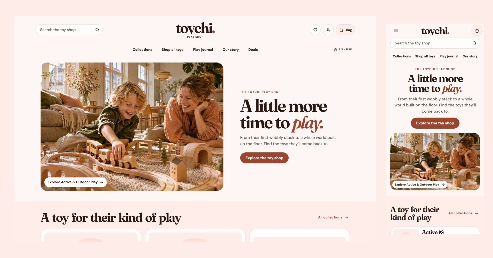
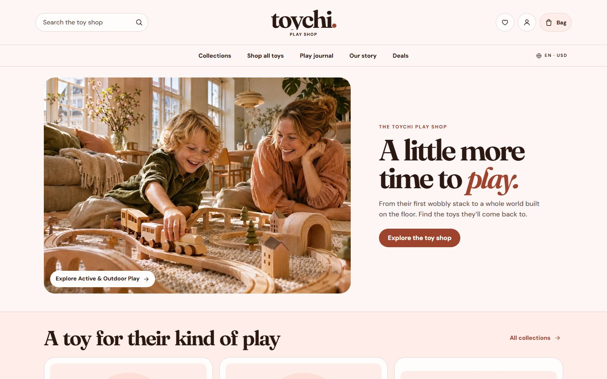
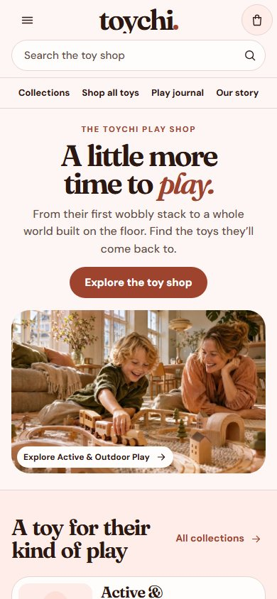
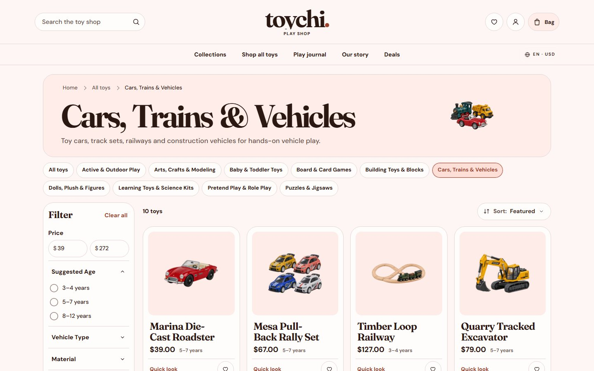
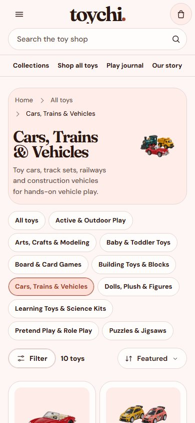
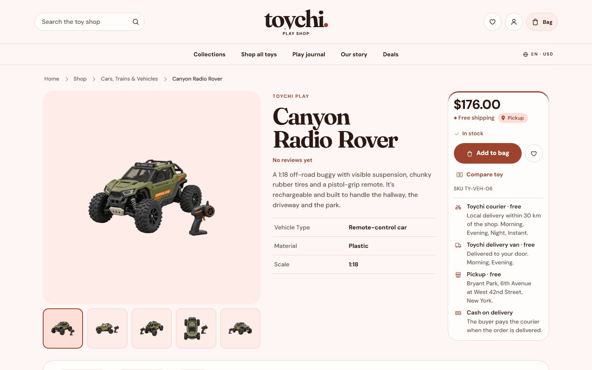
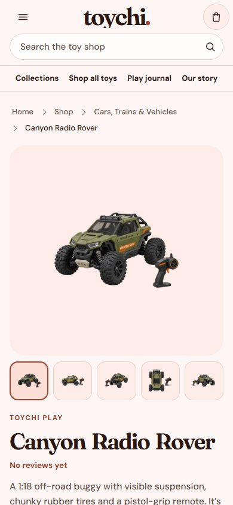
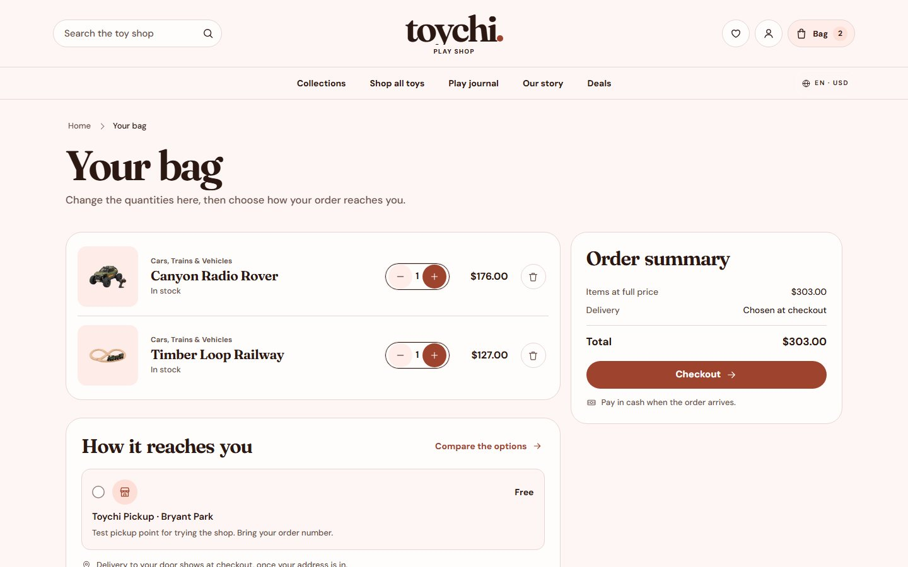
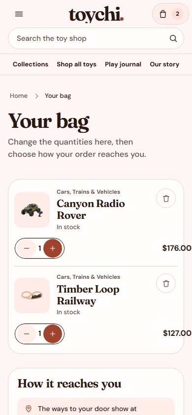

# Storybook Toy Shop

**Storybook Toy Shop** is a custom storefront **Layout** for Selldone shops: a toy shop with one seller, dressed as a warm storybook. A paper-coloured page with near-white cards and soft wash bands, one Clay accent, Fraunces over DM Sans, capsule buttons and 26 px panels. The shop's title is the centred lower-case wordmark with its dot; the home opens on a photo of a family at play; collection pages have a filter column built from the toys' own specification; the product page has a sticky buy box; the bag, the three-step checkout, the order page, the account, the journal and the shop's own pages are all inside the Layout. Everything is drawn in **one colour family** (every ground, line and word follows the palette's hue) and **one shape language** (a circle for round things, capsules for buttons and chips, 26 px panels, 14 px inner boxes). Light is the default, with a dark mode in the same family. It says **bag**, never cart. Every word it writes is in English and Arabic (right to left).

It runs on **[storybook.selldone.shop](https://storybook.selldone.shop)**, one domain of the Selldone shop toychi. The shop's default address and its other domains carry other Layouts; Storybook is pinned on its own domain only (see [Go Live](Go-Live)). It is built on the official [selldone/storefront](https://github.com/selldone/storefront), so Selldone's basket, checkout, payments and orders keep working underneath a new design.

## Start here

| I want to… | Page |
| --- | --- |
| Have an AI agent set it up on my shop | **[Install with AI](Install-with-AI)** |
| Set it up myself | [Manual Setup](Manual-Setup) |
| Know what my shop's data needs | [Shop Requirements](Shop-Requirements) |
| Build, upload and verify a release | [Build and Upload](Build-and-Upload) |
| Put it live on my shop or one domain | [Go Live](Go-Live) |
| Change the name, sections, pages, photos, languages | [Customize](Customize) |
| Change the colours, dark or light, the visitor switcher | [Theme and colours](Theme-and-colours) |
| Fix a problem | [Troubleshooting](Troubleshooting) |

## How a Selldone Layout works (one minute)

1. A **Layout** is a complete storefront app (Vue 3) that runs on Selldone's own servers instead of the default storefront.
2. You build it, zip it, and **upload** it to your Selldone developer account with the official [selldone-cli](https://github.com/selldone/cli). Each upload is a new **version**.
3. You **attach** a version to your shop, or to one domain of it.
4. Selldone injects **your** shop into the Layout: its title, collections, products, prices, delivery ways, payment methods, articles, languages, currencies and settings. Nothing about toychi is hard-coded: not the name (the wordmark is your shop's title), not a price, a collection or an age. The only shop-specific files are the three photos in `skins/storybook/photos/`; without them every photo slot shows a designed fallback made of your own products. Another toy shop that imports the Layout gets its own data.

## The look

| Part | Storybook |
| --- | --- |
| Grounds | a white page `#ffffff` with soft tint bands and cards `#ffede9`, plates `#fdece8`, a deeper tint `#fddfd7`, near-black ink `#2c1813`, muted words `#674f48`, lines `#e6d5d1`; a dark top bar and footer in the family's darkest shade `#2c1813` with words `#fff4f1`. These are the Clay values: with another palette or a custom colour every one of them takes that colour's hue |
| Action colour | Clay `#9d432e` (white words 6.41:1) on every button, chosen state and link; on the dark top bar and footer the family's light shade (`--ly-act-dk`, `#ef8d75`) marks the hover |
| Toys | the product's own photo on a light media plate in a fixed box (contain), in light and dark mode |
| Type and icons | Fraunces for headings, the wordmark and prices set large; DM Sans for reading, buttons and the nav; inline line icons; toy line drawings (blocks, a train, a teddy bear, a ball, a stacker, a kite, a top) where the base drew pastries |
| Shapes | one shape language: a circle for round things (icon buttons, the save heart, the map pin), capsules for buttons, chips, fields and the nav, 26 px for panels, cards and photos, 14 px for inner boxes (photo plates, thumbnails, the filter rows) |
| Buttons | flat; hover changes the colour only; no line under any word or icon (the one exception is a link inside a post's own text); selection rings inside the box |
| Photos | three photo slots (the welcome's `hero`, the journal and About's `feature`, the craft band's `craft`); without one, a designed fallback from your own products; never a caption or a file name |
| Theme | light by default; the other mode in the same family (for Clay: page `#170c09`, cards `#201411`, words `#fef4f2`, links `#ffffff`); four palettes (Clay, Rosewood, Olive, Indigo) and a custom colour, each re-tinting the whole page; a visitor switcher (a footer row) on the showcase shops only (see [Theme and colours](Theme-and-colours)) |
| Languages | English and Arabic (right to left); the language and currency pill on the link row |

## What you get

- **Header:** the search field on the left (live suggestions from the catalogue and a "Popular" row while it is empty; Enter opens every result), the shop's title as the centred lower-case wordmark with its dot and "PLAY SHOP" under it, and Saved toys, the account and the bag pill (its word and its count) on the right. Under it a row of links: Collections (opens the "Explore <shop>" drawer), Shop all toys, the play journal, Our story, Deals, and the language & currency pill. On a phone: the menu button, the wordmark and the bag on one line, the search field under them and the links in one sideways row; the drawer lists the collections (past eight, the first six and "Show N more"), the pages and the language row. There is no bottom tab bar.
- **Footer:** on the wash band, four columns: the wordmark with "Make time for play." and a link to the shop's story; Find a toy (every toy, the first collections, Deals); Here to help (FAQ, Contact, your orders); the journal's newest post as a small photo card. Then the Theme row (showcase only) and the legal row.
- **Home,** in this order (a section without its data folds away):
  1. **Welcome:** the `hero` photo in a rounded panel with a capsule to the most-ordered collection, beside "A little more time to *play.*" and **Explore the toy shop**;
  2. **A toy for their kind of play** on the wash band: the three collections with the most toys, each with its own image on an arched tint, its name and its description;
  3. **The playroom shelf:** four best sellers, one collection after another;
  4. **Find the right fit:** every age the toys' own specification names, youngest first, each opening the toys for that age;
  5. **From the play journal:** the newest post on the tint beside the `feature` photo;
  6. **A slow morning of making** on the wash band: the `craft` photo beside a collection about making things and **Shop <collection>**;
  7. **For a quiet afternoon:** four toys from a calm collection (puzzles, games, books…);
  8. **Good finds at every price** on the wash band: three round amounts from the live prices, each opening the toys up to it;
  9. **Notes from the playroom:** the four newest posts.
- **Collection, all toys, search and deals:** a title panel with the collection's own image (all toys: the `craft` photo), the collections as chips, the filter column (price boxes, then every spec group of the toys on the page, the age first; on the shop-wide pages only the rows most toys share), the count and **Sort**, and four story cards to a row. Deals without a running offer says so and shows "Good finds under <price>" from the live prices. A search with no result offers a new search and the collections.
- **Cards:** the toy on its plate, the collection, the name in Fraunces (two lines), the shop's real reviews when there are some (never demo ones), the price (the struck was-price only while a discount runs) and the toy's age; then **Quick look**, the save heart and **Add to bag**, which turns into "− n in bag +" in place.
- **Product page:** the breadcrumb; the gallery (the main photo and a row of thumbnails); the toy's brand, name, "No reviews yet" (or its real reviews), the first paragraph of its own article and its first three facts; a sticky buy box with the price, the stock, **Add to bag** and the save heart, **Compare toy**, the SKU and the shop's delivery and payment lines. Then the detail sheet: **Specifications** (the spec in your groups), **About this toy** (its article) and **Reviews** (an honest card with your rating criteria until the first review); **Buy together**; **More from <collection>**; a buy bar on a phone once the buy box has scrolled away.
- **Compare, quick view and saved toys:** the picks side by side with "Only differences" and "Copy link"; a quick view from each card; Saved toys (Selldone's wishlist, for a signed-in buyer) as story cards.
- **Bag and checkout:** a bag drawer ("Your bag", the lines with "− n +", the total, View bag and Checkout, "Often added"); the bag page with "How it reaches you" and the order summary; the checkout in three steps (Bag › Delivery › Payment): Contact, Delivery, the address or the pickup point, Billing and a note, with the order summary and **Place order** (or **Continue to payment**); the address sheet works with or without a map; then Selldone's payment window. Without a payment method it says plainly that the shop is not taking payment.
- **Orders and account:** the order page (where it stands, the toys, how it is paid, who receives it, the invoice and a chat with the shop); the account (Overview, Orders, Addresses, Saved toys, Profile); a sign-in sheet with your shop's own ways in and "Continue as guest" when guests may buy.
- **Content pages:** the play journal (the newest post large, the others beside it), each post (one reading column, "Shop this post", Share, the comments), About (one panel: the photo beside the story and the shop's facts), Terms, Privacy, FAQ, Contact (your real address, hours, map and a message form) and a 404 inside the Layout. The sample About, Terms, Privacy and FAQ text carries a visible "Sample text" label until the shop writes its own.

Storybook is a skin of the Layout base (`layout-base`) and keeps that buy flow underneath (Selldone's and the Kalio base's scripts for the bag, checkout, order, account, sign-in and compare); its colours, type, shapes, wordmark, home sections and photos are its skin's (`skins/storybook/skin.json`), its own components are in `components/ly/sb/` and its dress in `style/ly/sb.css`.

## Screenshots

| Desktop | Phone |
| --- | --- |
|  |  |
|  |  |
|  |  |
|  |  |

The three photos are the approved Storybook design's own lifestyle photos (Toychi Layout Mockups, shared/art).

## Tests

Every release is checked before it goes up (the production bundle through the live shop's own HTML) and on the live shop after it is pinned (the full suite, each check at `TOTAL 0`). The table for each version is in the repository's [`README.md`](https://github.com/selldone-custom-layouts/official-storybook/blob/main/README.md#tests).
